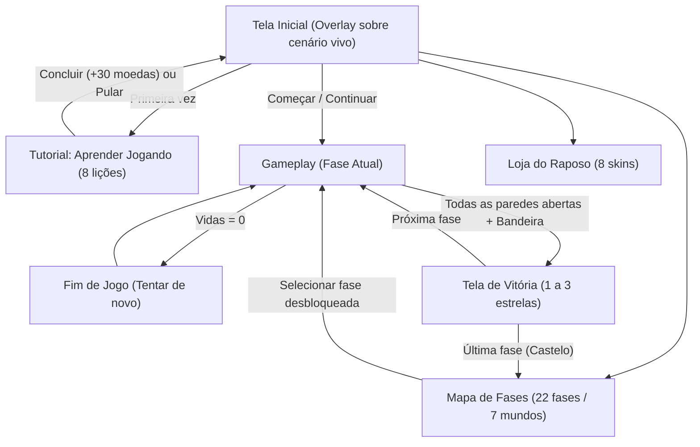

# Game Design Document (GDD) — MathCode

> **Subtítulo:** Aventura de Plataforma & Matemática  
> **Versão do Documento:** 1.2 (Ajustes da Ficha Técnica N2 implementados no código; pendente feedback do professor)  
> **Data:** 25/11/2026  
> **Instituição / Disciplina:** Católica SC — PAC: Jogos Digitais (Turma 4B)  
> **Integrantes:** Eduardo Alcala, João Paulo e Carlos Rodrigues  
> **Repositório GitHub:** `[PREENCHER: Link do repositório]`  
> **Versão Jogável:** `MathCode-Final.zip` (`index.html` + pasta `img/`)

---

## 1. Visão Geral (High Concept)

**MathCode** é um jogo 2D de plataforma e ação educacional (*edutainment*) desenvolvido em HTML5/JavaScript puro, que roda diretamente no navegador sem necessidade de instalação. O jogador controla **Pip**, um raposinho aventureiro acompanhado por **Pyrito**, um passarinho roxo mentor, em uma jornada por **7 mundos temáticos** e **22 fases** até o **Castelo do Chefe**.

Para avançar, o jogador precisa combinar agilidade de plataforma (pulos precisos, plataformas móveis, caixas quebráveis, espinhos e inimigos) com raciocínio matemático: grandes **Pedras das Contas** bloqueiam o caminho e só se abaixam quando Pip acerta o bloco correspondente ao resultado da operação exibida.

### Ficha Técnica Resumida

| Campo | Especificação |
|---|---|
| **Título** | MathCode — Aventura de Plataforma & Matemática |
| **Gênero** | Plataforma 2D / Ação / Educacional (Matemática) |
| **Público-alvo** | Estudantes do Ensino Fundamental (7 a 13 anos) e jogadores casuais |
| **Plataforma** | Navegador Web (Desktop com teclado; suporte a rolagem/toque no mapa) |
| **Tecnologia** | HTML5 Canvas 2D, CSS3, JavaScript (ES6), Web Audio API, `localStorage` |
| **Resolução Base** | 960 × 540 px (proporção 16:9, escalável e responsiva) |
| **Modo de Jogo** | Um jogador (*Single-player*) |
| **Idioma** | Português do Brasil (PT-BR) |

---

## 2. Proposta, Narrativa e Universo

### 2.1. Premissa e Objetivo
Ao longo de sete terras mágicas — do tranquilo **Vale dos Cogumelos** até o ardente **Vulcão Rúnico** —, antigas **Pedras das Contas** despertaram e passaram a bloquear as estradas que levam ao **Castelo do Chefe**. Guiado pelo sábio e encorajador **Pyrito**, **Pip** parte em uma jornada para atravessar os obstáculos de cada mundo, decifrar os enigmas matemáticos das pedras, coletar moedas e alcançar o topo do mapa.

### 2.2. Personagens

- **Pip (Protagonista):** Raposo laranja carismático de mochila e botinhas azuis, com visual cartoon de contorno escuro espesso. Ágil e expressivo, possui animações dedicadas de corrida (com cinemática inversa procedural nas pernas), pulo, queda, giro e oito variações visuais desbloqueáveis na **Loja do Raposo**.
- **Pyrito (Companheiro e Mentor):** Passarinho roxo (com postura de "gato-pássaro" planando quando Pip corre ou cai rápido). Acompanha o protagonista durante toda a aventura, celebra acertos, reage a tropeços e fornece **dicas pedagógicas contextuais** sem punir o aprendizado.
- **Pedras das Contas (Obstáculo Vivo):** Monólitos de pedra com olhos que permanecem adormecidos até Pip se aproximar, momento em que despertam, acompanham o jogador com o olhar e projetam o desafio matemático.
- **Planta Mordedora (Inimigo):** Planta carnívora roxa com folhas verdes e dentes pontiagudos que vigia o chão, telegrafa sua investida recuando a cabeça antes de morder e recompensa o jogador que aprende seu ritmo.

---

## 3. Fluxo de Telas e Experiência do Usuário (UX)



### 3.1. Interface e HUD
- **HUD em fase:** exibe em formato de pílulas arredondadas no canto superior esquerdo:
  - **Vidas:** 3 corações com suporte a meia vida (`❤️` inteira, `💔` meia vida, `🖤` perdida); no tutorial é substituído por `💚 Treino seguro`.
  - **Moedas:** contador acumulado (`🪙`).
  - **Caixas quebradas:** contador da fase (`📦`).
  - **Localização:** número da fase e nome do mundo atual (`Fase X · Nome do Mundo`).
- **Barra de Dicas do Pyrito:** cartão flutuante na base da tela com animações suaves para falas contextuais, dicas matemáticas e avisos de inimigos.
- **Barra de Controles:** legenda interativa abaixo do canvas que acende em tempo real conforme as teclas são pressionadas e, durante o tutorial, destaca apenas os controles ativos da lição atual.
- **Tema Adaptativo:** suporte nativo a modo claro e modo escuro conforme preferência do sistema operacional (`prefers-color-scheme`), além de respeito a `prefers-reduced-motion`.

---

## 4. Controles e Física (*Game Feel*)

### 4.1. Mapeamento de Controles

| Ação | Teclas Primárias | Teclas Alternativas | Observações |
|---|---|---|---|
| **Mover à esquerda** | `A` | `←` (Seta Esquerda) | Aceleração suave até 340 px/s |
| **Mover à direita** | `D` | `→` (Seta Direita) | Solta partículas de poeira acima de 120 px/s |
| **Pular** | `Espaço` | `W` ou `↑` | Altura variável (segurar = pulo alto; soltar cedo = pulinho) |
| **Giro (Ataque)** | `Shift` | `X` | Duração de 0,35 s e recarga de 0,20 s |
| **Fechar Mapa** | `Esc` | Botão "Voltar" | Retorna ao menu principal |

### 4.2. Parâmetros de Jogabilidade e Polimento
O controle de Pip foi calibrado para ser responsivo e justo para jogadores iniciantes:
- **Gravidade:** `940 px/s²` | **Impulso de pulo:** `-500 px/s` | **Corte de pulo ao soltar tecla:** `vy × 0,55`.
- **Coyote Time (`0,15 s`):** permite pular por uma fração de segundo após deixar a borda de uma plataforma ou chão.
- **Jump Buffer (`0,12 s`):** registra o comando de pulo instantes antes de tocar o chão, executando o salto automaticamente no pouso.
- **Invencibilidade temporária (`1,5 s`):** após levar dano ou reaparecer em checkpoint, Pip pisca e fica imune para evitar danos consecutivos injustos.
- **Câmera com Zoom Dinâmico:** acompanha Pip horizontalmente e aplica um zoom suave de `1,00×` para `1,12×` ao se aproximar de uma Pedra das Contas, focando a atenção no desafio matemático.
- **Feedback Corporal:** *squash-and-stretch* no salto, pouso, giro e dano; partículas coloridas em colisões, moedas, caixas e vitórias.

---

## 5. Mecânicas Principais (*Core Gameplay Loop*)

O ciclo central de cada fase alterna **ação de plataforma → desafio matemático → recompensa → progressão**:

1. **Exploração e Plataforma:** cada fase é dividida em **2 a 4 seções** (aumentando conforme a fase: `N = min(4, 2 + ⌊fase/2⌋)`), cada uma com `2.300 px` de percurso contendo plataformas fixas unidirecionais (*one-way*), plataformas móveis sobre buracos largos, pilhas de caixas, espinhos, buracos e Plantas Mordedoras.
2. **Encontro com a Pedra das Contas:** ao final de cada seção, uma parede de `260 px` bloqueia a passagem. Ao chegar a menos de `500 px`, a pedra abre os olhos e exibe uma conta matemática acima dela, enquanto **3 blocos de resposta** (ou **4 blocos** a partir de `fase + seção ≥ 3`) ficam suspensos diante dela.
3. **Resolução:** o jogador responde pulando por baixo do bloco escolhido (batendo com a cabeça) ou atingindo-o com o **Giro** (alcance de `78 px`).
   - **Resposta correta:** a parede desliza para o chão liberando o caminho, os demais blocos somem em confete dourado, Pyrito comemora e o jogador ganha **`+10 moedas`**.
   - **Resposta incorreta:** o bloco vibra em vermelho, a parede treme, o jogador perde **meia vida (`-0,5`)** e Pyrito exibe uma **dica pedagógica** explicando como pensar na conta.
4. **Conclusão:** após baixar todas as Pedras das Contas da fase e alcançar a **Bandeira amarela**, o jogador recebe de **1 a 3 estrelas** e desbloqueia a fase seguinte no mapa.

---

## 6. Design Pedagógico e Progressão Matemática

### 6.1. Curva de Operações Matemáticas
As contas são geradas dinamicamente (`gen(L)`) garantindo rejogabilidade e crescimento gradual de complexidade:

| Nível de Introdução | Operação / Formato | Intervalo e Escalonamento | Estratégia na Dica do Pyrito |
|---|---|---|---|
| **Fase 1** (`T=0`) | Multiplicação (`a × b`) | `3..9 × 3..9` | Tabuada ou decomposição em partes menores |
| **Fase 2** (`T=1`) | Divisão exata (`(a×b) ÷ b`) | Quociente e divisor entre `3..9` | Pensar na multiplicação inversa |
| **Fase 3** (`T=2`) | Adição de dezenas (`a + b`) | `12..49 + k` (`k = (L−6)×3` após fase 7) | Somar dezenas primeiro e depois unidades |
| **Fase 4** (`T=3`) | Subtração (`a − b`) | `b ∈ [12..45]+k`, diferença `12..50+k` | Subtrair dezenas e depois unidades |
| **Fase 5** (`T=4`) | Expressão mista (`a × b + c`) | `a,b ∈ [3..9]`, `c ∈ [5..25]+k` | Precedência: multiplicação antes da soma |
| **Fase 6** (`T=5`) | Fator oculto (`a × ? = res`) | `a ∈ [4..9]`, `? ∈ [6..12]` | Descobrir quantas vezes `a` cabe no total |
| **Fase 7+** (`T=6`) | Parênteses (`(a + b) × c`) | `a,b ∈ [2..9]`, `c ∈ [3..9]` | Resolver primeiro o que está entre parênteses |

> **Fases 8 a 22:** sorteiam dinamicamente entre os tipos `T=2` a `T=6`, elevando os valores numéricos progressivamente (`k`) e utilizando **4 opções de resposta** com distratores plausíveis próximos ao resultado correto (`±12%`, mínimo `±3`).

### 6.2. Tutorial "Aprender Jogando" (*Onboarding*)
Para novos jogadores (`!S.tut && !S.L && !S.coins`), o botão principal já convida diretamente para o tutorial, construído sobre três princípios:
1. **Uma ação por vez:** cada lição desbloqueia apenas o controle necessário e mantém os comandos futuros bloqueados e esmaecidos na barra inferior.
2. **Tentativa segura:** ninguém perde vidas no treino; erros retornam Pip ao checkpoint imediato com mensagens acolhedoras. Após **3 erros** ou **16 segundos** sem avançar, surge uma dica reforçada — e na Pedra das Contas, após 3 erros, o bloco correto brilha em verde para evitar frustração.
3. **Retorno perceptível:** concluir cada etapa abre o portão mágico, dispara partículas, texto flutuante, efeitos sonoros sutis e muda o cartão do treinador para verde.

#### Sequência das 8 Lições do Tutorial
1. **Andar:** coletar 3 moedas usando `→` ou `D`.
2. **Pular:** saltar sobre o primeiro buraco (libera `Espaço`/`W`).
3. **Espinhos:** desviar de espinhos no chão.
4. **Caixas:** quebrar uma caixa pulando em cima dela (`+2 moedas` + impulso).
5. **Giro:** derrubar uma pilha de 4 caixas altas usando `Shift`/`X` (reconstrói automaticamente se o jogador tentar quebrar sem girar).
6. **Planta Mordedora:** observar o recuo da cabeça e derrotar o inimigo com pulo ou giro (`+3 moedas`).
7. **Pedra das Contas:** resolver uma soma simples (`3 + 2 = ?`) para aprender o gesto de resposta.
8. **Teste Final:** percurso completo combinando buraco, espinhos, Planta Mordedora, multiplicação de tabuada e bandeira final.

Ao finalizar pela primeira vez, o jogador recebe um **bônus único de +30 moedas**.

---

## 7. Inimigos, Obstáculos, Economia e Progressão

### 7.1. Obstáculos e Inimigos

| Elemento | Comportamento | Interação / Dano | Recompensa |
|---|---|---|---|
| **Caixas de Madeira** | Bloqueiam o caminho ou ficam sobre plataformas | Quebram com pulo por cima (quique `-340 px/s`) ou Giro (`< 62 px`) | `+2 moedas` |
| **Buracos** | Lacunas no piso (às vezes com plataforma móvel) | Queda custa `-1 vida` e retorna ao último checkpoint | — |
| **Espinhos** | Fileiras pontiagudas sobre o solo | Contato custa `-1 vida` e retorna ao último checkpoint | — |
| **Plataformas Móveis** | Oscilação horizontal suave (senoidal) sobre abismos largos | Transportam Pip automaticamente quando está apoiado | — |
| **Planta Mordedora** | IA de 4 estados: *vigia → recuo/aviso (0,38 s) → mordida (0,24 s) → pausa (0,7 s)* | Derrotada por pulo na cabeça (quique `-430 px/s`) ou Giro (`< 90 px`); mordida/toque lateral causa `-1 vida` + *knockback* | `+3 moedas` |

### 7.2. Sistema de Vidas e Avaliação por Estrelas
- O jogador inicia cada fase com **3 vidas** (`3.0`).
- **Perda de vida:** buracos, espinhos e Planta Mordedora removem `1,0` vida; errar uma conta matemática remove `0,5` vida.
- **Estrelas ao concluir a fase:**
  - ★★★ (`3 estrelas`): concluir com as `3` vidas intactas.
  - ★★☆ (`2 estrelas`): concluir com `2` ou `2,5` vidas restantes.
  - ★☆☆ (`1 estrela`): concluir com menos de `2` vidas restantes.
- Fases concluídas podem ser rejogadas pelo **Mapa de Fases** para melhorar a pontuação (o recorde de estrelas nunca diminui).

### 7.3. Economia e Loja do Raposo (8 Skins)
As moedas coletadas ficam salvas permanentemente no navegador (mesmo em caso de *Game Over*):
- **Ganhos:** Moeda solta (`+1`), Caixa (`+2`), Planta Mordedora (`+3`), Pedra das Contas (`+10`), Conclusão do Tutorial (`+30`, uma única vez).

| # | Nome da Skin | Preço (Moedas) | Efeito Visual em Jogo | Arte na Loja |
|---|---|---|---|---|
| 0 | **Pip Clássico** | Grátis (0) | Visual padrão laranja/creme | `img/skin0.png` |
| 1 | **Capa de Herói** | 80 | Capa vermelha esvoaçante que reage à corrida e ao pulo | `img/skin1.png` |
| 2 | **Óculos Radicais** | 120 | Óculos escuros com reflexo branco | `img/skin2.png` |
| 3 | **Chapéu de Mago** | 160 | Chapéu roxo pontudo com estrela dourada | `img/skin3.png` |
| 4 | **Faixa Ninja** | 200 | Pelagem azul-acinzentada + bandana vermelha animada | `img/skin4.png` |
| 5 | **Pijama de Dragão** | 260 | Pelagem verde-clara + cristas dorsais amarelas | `img/skin5.png` |
| 6 | **Coroa Real** | 340 | Coroa dourada de três pontas | `img/skin6.png` |
| 7 | **Astronauta** | 450 | Pelagem branca + capacete espacial translúcido com brilho | `img/skin7.png` |

> **Custo total da coleção completa:** `1.610 moedas`.

---

## 8. Mundos, Direção de Arte e Áudio

### 8.1. Os 7 Mundos e o Mapa de Fases (22 Fases)
O **Mapa de Fases** apresenta uma trilha vertical sinuosa (curva Catmull-Rom de `960 × 4500 px`), percorrida de baixo para cima atravessando rios com pontes de madeira — e um rio de lava com ponte de pedra antes do mundo final. Ao concluir uma nova fase, Pip e Pyrito caminham animadamente pelo mapa até o próximo nó.

| Mundo | Fases | Identidade Visual e Animações de Fundo |
|---|---|---|
| **1. Vale dos Cogumelos** | Fases 1–3 (+ Tutorial) | Céu azul ensolarado, colinas verdes, nuvens à deriva, árvores/flores balançando, cogumelos "respirando", borboletas e vagalumes. |
| **2. Caverna de Cristais** | Fases 4–6 | Subterrâneo roxo-azulado, estalactites, aglomerados de cristais ciano/magenta brilhantes, cogumelos luminosos e gotas d'água caindo. |
| **3. Floresta Enluarada** | Fases 7–9 | Noite mágica com lua cheia, névoa baixa à deriva, árvores gigantes com cipós luminosos balançando, samambaias e vagalumes verdes. |
| **4. Dunas Douradas** | Fases 10–12 | Entardecer alaranjado com sol e raios rotativos, dunas, ruínas antigas, cactos, pássaros no horizonte e planta rolante (*tumbleweed*). |
| **5. Montanha Gelada** | Fases 13–15 | Nevasca contínua, aurora boreal ondulante no céu, picos nevados, pinheiros com neve e cristais de gelo cintilantes. |
| **6. Galáxia Neon** | Fases 16–18 | Espaço sideral roxo-índigo, nebulosas, planetas com anéis flutuando, ilhas suspensas, cristais neon e estrelas cadentes periódicas. |
| **7. Vulcão Rúnico** | Fases 19–21 + **Fase 22 (Castelo do Chefe)** | Céu vulcânico rubro, vulcões com lava pulsante, obeliscos com runas incandescentes, rachaduras brilhantes no solo e brasas ascendentes. |

### 8.2. Estilo Visual
- **Estética Cartoon 2D:** traços arredondados e contornos escuros uniformes (`#2b1b3d`), paleta vibrante de alto contraste para facilitar leitura de elementos jogáveis vs. cenário.
- **Paralaxe em Camadas:** cada mundo pré-renderiza suas camadas em *tiles* contínuos (`1280 × 470 px`) com fatores de deslocamento distintos (`0.03` a `0.55`) e sprites animados independentes.
- **Tipografia:** fonte arredondada **Fredoka** (Google Fonts) com fallback seguro (`Trebuchet MS, sans-serif`).

### 8.3. Direção Sonora
- Sintetizador procedural leve implementado com **Web Audio API**, sem dependência de arquivos MP3/WAV externos (funciona 100% offline no ZIP).
- **Trilha Sonora Procedural (`BGM_THEMES`):** loop melódico adaptativo com tema próprio para cada um dos 7 mundos, atenuação automática no menu/pausa (*ducking*) e pausa automática quando a aba fica em segundo plano.
- **Efeitos Sonoros Completos (`sfx()`):** sons distintos para pulo, giro, coleta de moeda, quebra de caixa, derrota da Planta Mordedora, acerto da Pedra das Contas, erro de resposta, dano/queda, abertura de portão, clique de menu, vitória e *Game Over*.
- **Controles do Jogador:** botão rápido de mudo (`🔊/🔇`) no HUD e no menu inicial + sliders independentes de volume de **Música** e **Efeitos** no Menu de Pausa, salvos em `localStorage` (`mVol`, `sVol`, `mute`).

---

## 9. Arquitetura Técnica e Persistência

- **Estrutura de Arquivos:**
  - `index.html`: contém toda a interface (HTML/CSS), engine de física, renderização Canvas 2D, gerador procedural de cenários/mapa, tutorial, loja e atlases base64 (`PIP_ATLAS` e `BIRD_ATLAS`).
  - `img/skin0.png` .. `img/skin7.png`: ilustrações de vitrine das 8 skins da Loja do Raposo.
  - `LEIA-ME.txt` / `README.md`: instruções rápidas de uso e controles.
  - `GDD.md`: este documento de design.
- **Salvamento Local (`localStorage`):** salvo automaticamente sob a chave `'mathcode'` no formato JSON:
  ```json
  {
    "coins": 0,
    "L": 0,
    "own": [0],
    "eq": 0,
    "tut": 0,
    "mute": 0,
    "st": []
  }
  ```
- **Desempenho e Portabilidade:** `requestAnimationFrame` com `dt` limitado a `0,033 s` para estabilidade física, pré-renderização de camadas estáticas de fundo e mapa em canvases dedicados (*offscreen caching*) para manter 60 fps fluidos mesmo em notebooks simples.

---

## 10. Histórico de Evolução — Ajustes Pós-N2 (Devolutivas)

Avaliação entre grupos realizada em **29/10/2026** (equipe avaliadora: Ana Soares, Gustavo Necal, Sofia e Amandha).  
**Pontos fortes mantidos:** Loja do Raposo interativa, controles responsivos, tutorial claro e alta vontade de jogar novamente (nota 5/5).

| Origem da Devolutiva | Sugestão / Problema Identificado | Ajuste Planejado / Implementado na Versão Final | Impacto Esperado na Experiência do Jogador |
|---|---|---|---|
| **Ficha Técnica N2** | **Falta de menu** (especialmente para pausar ou finalizar/sair para o menu inicial após morrer) | Adicionar botão de **Pausa / Menu** no HUD (e tecla `Esc`/`P`) durante a partida + opção explícita **"Voltar ao Menu Principal"** na tela de *Fim de Jogo* e na pausa | Dá controle total de navegação ao jogador, evitando sensação de ficar "preso" na fase após morrer |
| **Ficha Técnica N2** | **Ausência de música e efeitos sonoros** nas fases ("Adicionar uma musiquinha e efeitos / Áudio") | Implementar trilha sonora procedural leve (Web Audio API) + efeitos sonoros completos (pulo, giro, moeda, caixa, planta, acerto, erro, dano, vitória e *game over*) + controles de volume/mudo independentes | Aumenta drasticamente a imersão, o ritmo e o retorno sensorial das ações durante toda a partida |
| **Ficha Técnica N2** | **Fases escuras difíceis de enxergar** (destacada a **Fase 5 — Caverna de Cristais**) | Melhorar iluminação de fundo, contraste de plataformas, destaque visual nas bordas de buracos e espinhos e leve contorno/halo de leitura em mundos escuros (Caverna, Floresta, Galáxia e Vulcão) | Garante leitura imediata de perigos e plataformas sem perder a atmosfera temática de cada mundo |
| **Ficha Técnica N2** | **Desafio e ritmo** (único critério nota 3/5 na ficha) | Revisar ritmo das seções, curva de dificuldade e feedback de progresso dentro da fase *(a alinhar também com o feedback do professor)* | Mantém o jogo dinâmico, sem trechos repetitivos ou frustrantes |
| **Feedback do Professor** | `[AGUARDANDO FEEDBACK DO PROFESSOR]` | `[PREENCHER]` | `[PREENCHER]` |
